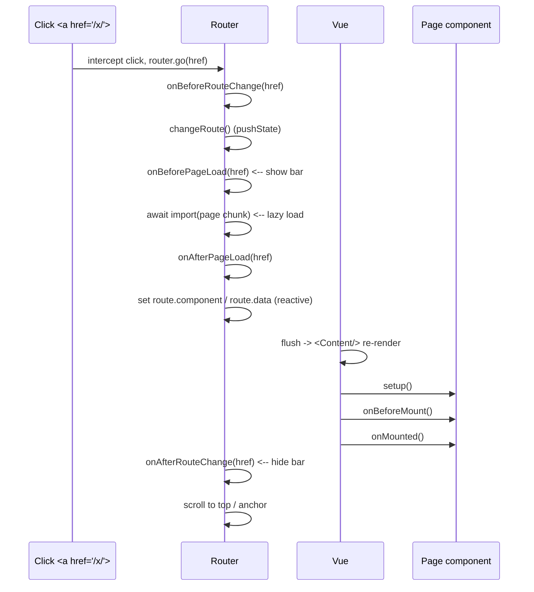

# Route loading indicator

## Purpose

VitePress builds every page to static HTML but, on client-side navigation, lazily imports each destination page as its own JavaScript chunk. This produces a brief loading gap when switching routes. A thin top progress bar is shown during that window so the transition reads as intentional rather than as a flash or jump.

The bar is deliberately minimal: a 2px line sweeping across the very top, using the site's `--link` accent color, with no motion beyond the sweep itself.

## Route transition timing

A client navigation (clicking an internal in-page link) flows through the VitePress router as follows:



The loading window therefore spans exactly `onBeforePageLoad` through `onAfterRouteChange`. The real latency lives in the `import()` of the destination chunk; the page component is mounted during the Vue flush that follows.

Back/forward navigation (popstate) skips `onBeforeRouteChange` but still triggers `onBeforePageLoad` and `onAfterRouteChange`, so the bar works there too.

## Component lifecycle

The routed page is a Vue component whose Composition API hooks run during the flush that mounts it — see the `Page component` rows in the sequence diagram above. The useful facts are:

- `setup()` runs first, before the component is inserted into the DOM.
- `onBeforeMount` fires immediately before insertion; `onMounted` fires after insertion and is where DOM access and data-fetch kickoff belong.
- `onUpdated` runs after a reactive change triggers a re-render.
- `onBeforeUnmount` / `onUnmounted` run when navigating away, and are the place to remove listeners, timers, and subscriptions.
- Vue invokes every hook **synchronously**. An async hook's returned Promise is ignored (a floating promise), so it cannot delay the mount or the routing window.

## Initial load vs SPA navigation

- **Initial full-page load / direct URL:** no `router.go()` runs. The server-rendered HTML is served and then hydrated, so the loading bar does not appear.
- **Client-side navigation (link click, back/forward):** only this path triggers the route loading hooks and the bar.

## Implementation

- `src/components/site/...` not used; the bar lives in the theme layout.
- `.vitepress/theme/Layout.vue` registers the router hooks:

  ```ts
  router.onBeforePageLoad = (to) => {
    const toPath = pathOnly(to)
    const currentPath = pathOnly(router.route.path)
    if (toPath !== currentPath) isRouteLoading.value = true
  }
  router.onAfterRouteChange = () => {
    isRouteLoading.value = false
  }
  ```

  `isRouteLoading` toggles a fixed, `pointer-events-none` bar via `v-show`. Comparing paths keeps in-page anchor scrolls from flashing the bar.

- `src/styles/globals.css` defines the sweep keyframe `route-loading` (translateX from `-100%` to `400%`).

## Why async lifecycle awaits do not extend the bar

An async `onBeforeMount` / `onMounted` (for example `onBeforeMount(async () => { await delay(3000) })`) does not keep the bar visible:

- Vue invokes lifecycle hooks synchronously and does not await a returned Promise.
- The bar is driven by the router, which reaches `onAfterRouteChange` as soon as the chunk is resolved, regardless of anything the page does in its own lifecycle.

To gate rendering on a real async dependency, make the page an async component (top-level `await`) and wrap `<Content />` in `<Suspense>`, letting the fallback hold the loading state.

## Verification

```bash
npm run typecheck
npm run lint
npm run build
```

A browser check confirmed the bar appears on a route change and does not flash for in-page anchor navigation.
